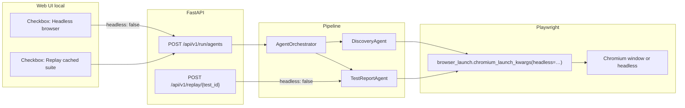
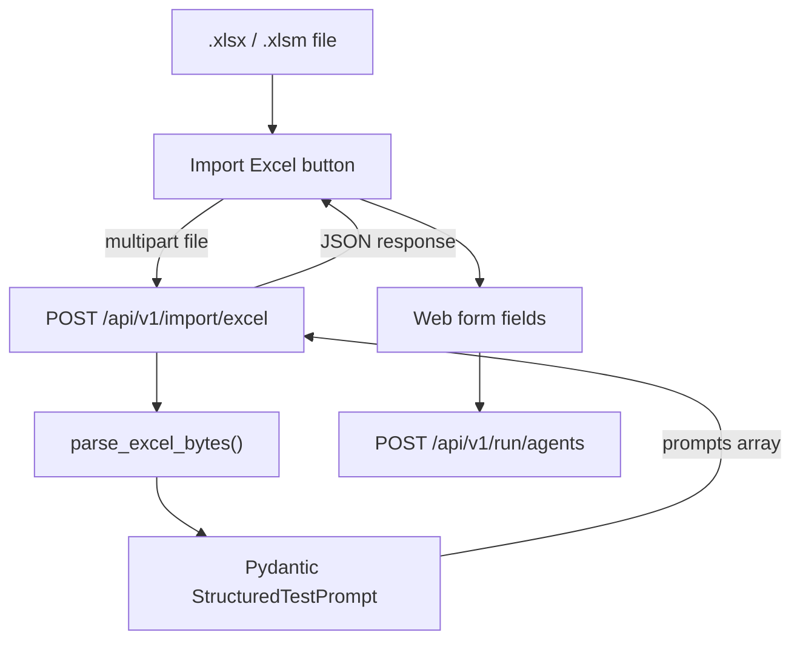

# Phase Architecture — Required Work (Dassault Mentor Phase)

| Field | Value |
|---|---|
| **Project** | DS-1 — Agentic Web-App Test Executor |
| **Document focus** | Architecture for **phase-required** features (Sep 3 & Sep 24, 2026) |
| **Checklist** | [SEP3_ACTION_ITEMS.md](./SEP3_ACTION_ITEMS.md) |
| **Full system reference** | [ARCHITECTURE.md](./ARCHITECTURE.md) |

This document describes **what the phase required** and **how it is implemented in this repo**. It is not a repeat of the whole product architecture; it concentrates on deliverables requested for this evaluation period, with full design detail for **visible (non-headless) test execution** and **Excel integration**.

---

## 1. Phase requirements overview

| # | Requirement (mentor / phase) | Status | Primary location |
|---|---|---|---|
| 1 | Locator caching | Done | `src/agents/artifact_store.py` (`LocatorStore`) |
| 2 | Suite JSON + replay | Done | `SuiteStore`, `use_replay` in orchestrator |
| 3 | LLM tokens + LangSmith | Done | `llm_client.py`, `llm_observability.py` |
| 4 | Phase timing in reports | Done | `performance_summary.py`, UI panel |
| 5 | Faster re-runs (cache/replay) | Partial | Locator hit + replay mode |
| 6 | Cookie / session clearance | Done | `runner.py`, `ZOHO_TC06` sample |
| 7 | Healer trace in report | Done | `healer.py`, `test_report_agent.py` |
| 8 | Persistent storage (GCS) | Done | `artifact_storage.py` |
| 9 | **Excel import** | Done | `src/importers/excel_importer.py` |
| 10 | **Visible browser (non-headless) runs** | Done | `headless` flag end-to-end (local) |
| 11 | Restore suite after redeploy | Done | `POST /api/v1/suites/upload` |

Sections **2** and **3** below are the dedicated architecture for items **9** and **10**.

---

## 2. Visible browser execution (non-headless)

### 2.1 Phase requirement

Mentors asked for the ability to **watch tests run in a real browser window**, especially when **replaying** a cached Playwright suite, so failures and locator behaviour can be demonstrated without reading logs only.

**Constraint:** Google Cloud Run has no display server. Visible browser is supported on **developer machines** (local FastAPI or CLI). Production Cloud Run remains **headless only**.

### 2.2 Design principle

`headless` is a **single boolean** passed from the interface through the API into every Chromium launch (discovery scan, test execution, replay). Default is `true` for CI and cloud; user sets `false` for local demos.

### 2.3 Architecture diagram



### 2.4 Component wiring (this repo)

| Layer | File | Behaviour |
|---|---|---|
| **UI** | `frontend/index.html` | Checkbox `#headless` (default checked). Hint: uncheck for visible replay locally. |
| **UI** | `frontend/static/js/app.js` | `runTest()` sends `headless: $("headless").checked` in JSON body. |
| **API models** | `src/backend/app.py` | `AgentRunBody.headless`, `StructuredRunBody.headless`, `ReplayRequest.headless` (default `True`). |
| **Orchestrator** | `src/agents/orchestrator.py` | Passes `headless` to `DiscoveryAgent` and `TestReportAgent`. |
| **Discovery** | `src/agents/discovery_agent.py` | `chromium.launch(**chromium_launch_kwargs(headless=self.headless))`. |
| **Execute** | `src/agents/test_report_agent.py` | `PlaywrightExecutor(headless=self.headless)`. |
| **Executor** | `src/executor/runner.py` | Uses `self.headless` on launch. |
| **Launch helper** | `src/executor/browser_launch.py` | Container-safe args when `K_SERVICE` / Docker; **does not force headless** — honours caller flag. |
| **CLI** | `scripts/run_suite.py` | `--headed` sets `headless=False` for local runs. |
| **Streamlit** | `demo/streamlit_app.py` | “Headless browser” checkbox (legacy local demo). |
| **Defaults** | `src/common/settings.py` | `headless: bool = True` when env not overridden. |

### 2.5 Recommended mentor demo flow (visible replay)

1. Run a **full pipeline** once (headless is fine) so `data/suites/{test_id}_latest.json` exists.
2. On **localhost** (`uvicorn src.backend.app:app`), open the dashboard.
3. **Check** “Replay cached suite”.
4. **Uncheck** “Headless browser”.
5. Run — Chromium opens visibly; Playwright replays cached steps without re-running LLM/discovery.

Same flags apply when calling the API directly:

```json
POST /api/v1/run/agents
{
  "prompt": { "test_id": "TC01", "...": "..." },
  "use_replay": true,
  "headless": false,
  "use_healer": true
}
```

### 2.6 Local vs Cloud Run

| Environment | Visible browser | Notes |
|---|---|---|
| Local Windows/macOS/Linux | Yes | Uncheck headless or CLI `--headed` |
| Cloud Run | No | No display; keep `headless: true` |
| Docker on laptop | Yes | Run API locally, not only inside headless container |

Documented in [DEPLOY_CLOUD_RUN.md](./DEPLOY_CLOUD_RUN.md) and UI hint in `frontend/index.html`.

### 2.7 Out of scope

- Remote “VNC into Cloud Run” or streaming browser video.
- Headed mode on serverless production (not required for phase sign-off).

---

## 3. Excel integration

### 3.1 Phase requirement

Mentors asked to **import test cases from Excel** (QA / Dassault-style sheets) instead of typing each structured prompt manually or maintaining one YAML per row. Imported rows must map to the same **`StructuredTestPrompt`** contract as the web form and YAML samples.

### 3.2 Design principle

Excel is an **input adapter** only: `.xlsx` → list of `StructuredTestPrompt` → existing run pipeline. No separate execution path.

### 3.3 Architecture diagram



### 3.4 Implementation (this repo)

| Piece | Path | Role |
|---|---|---|
| Parser | `src/importers/excel_importer.py` | `parse_excel_bytes(data, sheet_index=0)` |
| API | `src/backend/app.py` | `import_excel_tests` — `UploadFile`, returns `{ count, prompts[] }` |
| UI | `frontend/index.html` | Hidden file input + **Import Excel** button |
| UI logic | `frontend/static/js/app.js` | `importExcelFile()` → fills form with **first** row; shows count if multiple |
| Dependency | `requirements.txt` | `openpyxl`, `python-multipart` (required for file upload on FastAPI) |
| Tests | `tests/unit/test_excel_importer.py` | Row parsing, headers, steps columns |

### 3.5 Column contract

Header row is matched with **flexible aliases** (case-insensitive). Required logical columns:

| Field | Example header names |
|---|---|
| `test_id` | Test ID, id, case_id |
| `site_url` | Site URL, url, application_url |
| `feature` | Feature, module |
| `test_name` | Test Name, name, title |
| `objective` | Objective, test_objective |
| `expected_outcome` | Expected Outcome, expected result |
| **Steps** | Multiline **Steps** cell **or** columns `Step 1`, `Step 2`, … |

Optional: `environment`, `owner_team`.

Parsing rules (`excel_importer.py`):

1. Skip empty rows; skip rows without `test_id`.
2. Steps: split multiline cell on newlines, strip numbering; or collect `step_*` columns in order.
3. `environment` mapped to `develop` / `stage` / `prod` enum.
4. Each row validated as `StructuredTestPrompt` before return.

### 3.6 API specification

```
POST /api/v1/import/excel
Content-Type: multipart/form-data
  file: (binary .xlsx or .xlsm)
  sheet_index: 0   (optional query param)

200 OK
{
  "count": 3,
  "prompts": [ { ...StructuredTestPrompt JSON... }, ... ]
}

400 — missing columns, no steps, empty sheet
500 — unexpected parse error
```

After import, the UI loads **`prompts[0]`** into the form. User selects **Run** (with agent/replay/headless toggles as usual). Additional rows can be supported in a future UI list; phase requirement is **import + run** via standard form.

### 3.7 Deployment note

Cloud Run revision must include **`python-multipart`**. Without it, FastAPI raises at startup for the Excel route. See deploy fix in project history (`requirements.txt`).

### 3.8 Error handling

| Failure | User-visible result |
|---|---|
| Wrong file type | 400 — upload `.xlsx` / `.xlsm` only |
| Missing required column | 400 — lists missing fields and mapped headers |
| Row without steps | 400 — `test_id` called out |
| No data rows | 400 — empty workbook |

---

## 4. Other phase requirements (summary)

Brief pointers only; see [ARCHITECTURE.md](./ARCHITECTURE.md) for full design.

| Requirement | Architecture summary |
|---|---|
| Locator cache | `LocatorStore` + `GET /api/v1/locators`; keys `site_url` + `feature` |
| Suite replay | `SuiteStore` + `use_replay`; skips Agents 1–2 |
| GCS persistence | `artifact_storage.py`; dual-write with local `data/` |
| Suite upload | `POST /api/v1/suites/upload` restores replay after redeploy |
| Observability | `llm_calls`, `phase_timings` on `TestReport`; optional LangSmith |

---

## 5. How the two main features work together

Typical **phase demo script**:

1. **Import Excel** — load a row from the team’s QA sheet into the form.
2. **Full run** (headless) — generate suite, discovery, cache artifacts.
3. **Replay** with **headless off** — show visible browser replay to mentors.
4. Optional: download suite JSON; on another machine, **upload suite** and replay again.

---

## 6. Related documents

| Document | Content |
|---|---|
| [SEP3_ACTION_ITEMS.md](./SEP3_ACTION_ITEMS.md) | Mentor checklist and Excel header table |
| [STRUCTURED_PROMPT.md](./STRUCTURED_PROMPT.md) | Fields Excel must populate |
| [DEPLOY_CLOUD_RUN.md](./DEPLOY_CLOUD_RUN.md) | Headless-only production |
| [DEMO_PREP.md](./DEMO_PREP.md) | Speaking points for demo |

---

*Last updated: October 2026 — phase-required work: visible browser + Excel integration.*
